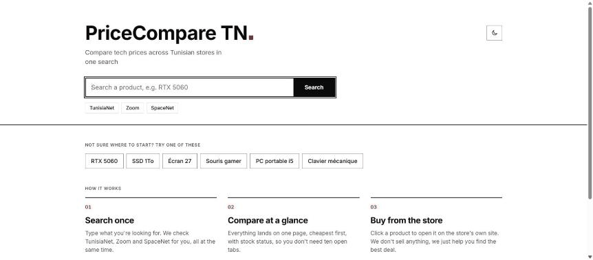
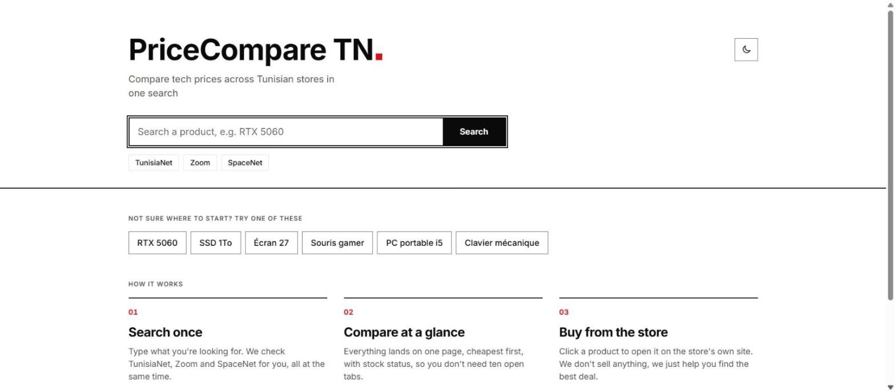
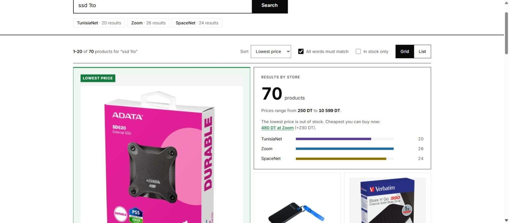
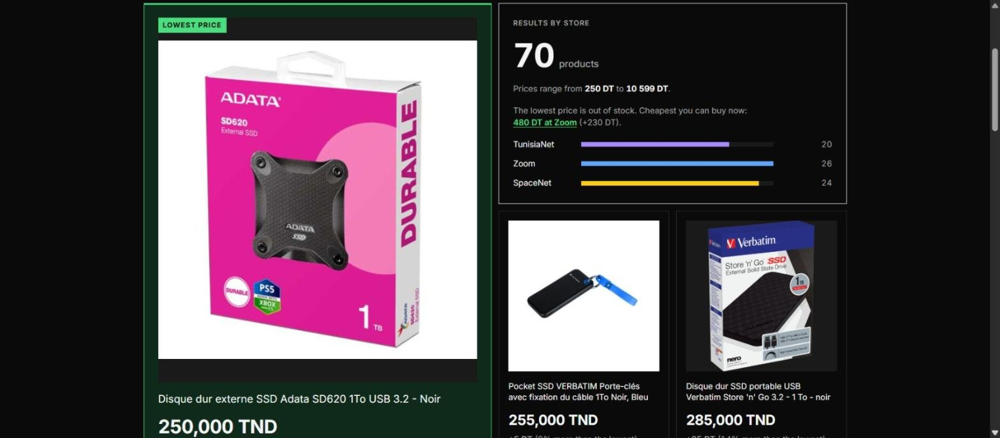
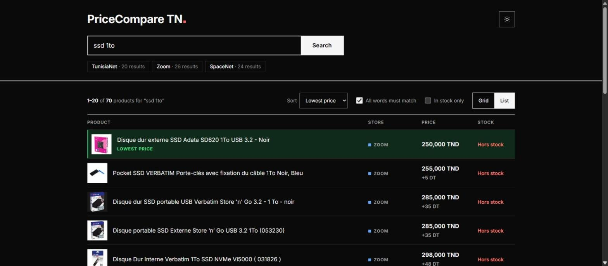
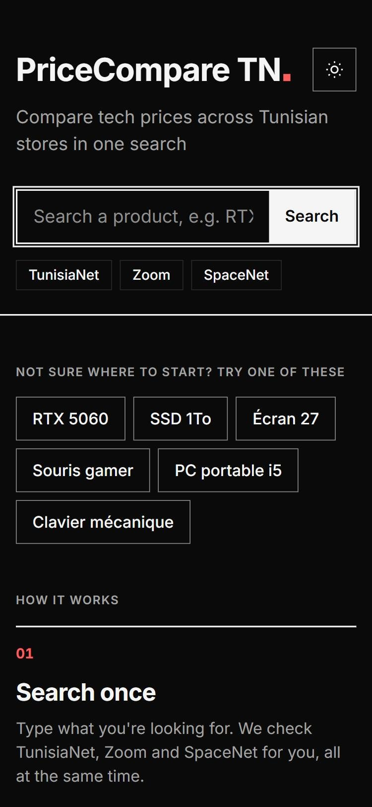
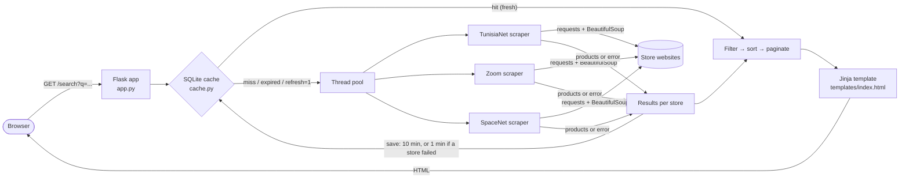

# PriceCompare TN

Compare tech prices across Tunisian online stores in one search.

PriceCompare TN is a small Flask web app that searches **TunisiaNet**, **Zoom** and **SpaceNet** at the same time, merges the results and shows them cheapest first, with stock status, price differences, filters and pagination.



## Screenshots

| Landing page | Results (grid) |
| --- | --- |
|  |  |
| **Dark mode** | **List view (dark)** |
|  |  |

<p align="center"></p>

## Features

- **One search, three stores.** The stores are scraped in parallel, so a search takes about as long as the slowest store (usually 3 to 8 seconds).
- **Clear price comparison.** The cheapest product gets a large "Lowest price" tile, and every other product shows how much more it costs (for example "+35 DT, 14% more than the lowest"). A summary tile shows the price range and how many results each store returned. If the cheapest item is out of stock, it tells you the cheapest one you can actually buy.
- **Loading state.** While the stores are being checked, you see which stores are being searched and placeholder cards instead of a frozen page.
- **Helpful empty results.** If nothing matches, the page explains why: filters hid everything (with one-click links to relax them), every store was unreachable (with a retry link), or nothing matched (with search tips).
- **Store failures are visible.** If a store is down or blocks the request, its label turns red with a warning icon, a notice explains what happened in plain words, and the other stores' results still show. A "Try again" link re-checks the stores, skipping the cache.
- **Image fallbacks.** Missing or broken product images are replaced with a neutral placeholder. Lazy-loaded images (stores that put the real URL in `data-src` or `data-original`) are handled.
- **Filters and sorting.** Sort by lowest price, highest price or store order. Keep only products in stock, or only products whose name contains every word you searched (accent-insensitive, so `rtx5060` also matches `RTX 5060`).
- **Two layouts.** A bento grid and a compact list. On phones the list turns into stacked cards.
- **Persistent cache.** Results are stored in SQLite for 10 minutes (1 minute if a store failed), so paging and filtering are instant and the cache survives a restart. Expired entries are deleted automatically.
- **Light and dark mode** that follows your system setting, with a toggle that remembers your choice.
- **Accessible.** WCAG AA contrast in both themes, visible keyboard focus, 44px touch targets, screen-reader labels, and support for "reduce motion".

## Example search results

A real search for `rtx 5060`, taken on 20 November 2026. Prices change often, so treat these as an illustration.

**82 products found:** 46 from TunisiaNet, 12 from Zoom, 24 from SpaceNet. These are the five cheapest:

| # | Store | Product | Price | Stock |
| --- | --- | --- | --- | --- |
| 1 | TunisiaNet | Carte graphique PNY GeForce RTX 5060 / 8 Go GDDR7 | 1 799 DT (lowest) | En stock |
| 2 | TunisiaNet | Carte graphique MSI GeForce RTX 5060 SHADOW 2X OC BULK / 8 Go GDDR7 | 1 849 DT (+50 DT) | En stock |
| 3 | TunisiaNet | Carte graphique Gigabyte GeForce RTX 5060 WINDFORCE OC / 8 Go GDDR7 | 1 859 DT (+60 DT) | En stock |
| 4 | TunisiaNet | Carte graphique MSI GeForce RTX 5060 VENTUS 2X OC / 8 Go GDDR7 | 1 879 DT (+80 DT) | En stock |
| 5 | TunisiaNet | Carte graphique MSI GeForce RTX 5060 VENTUS 2X OC / 8 Go GDDR7 | 1 879 DT (+80 DT) | En stock |

Most of the Zoom and SpaceNet results for this search are gaming PCs that contain an RTX 5060, which is why they appear further down when sorting by price.

## Architecture



1. `app.py` receives `/search?q=...` and checks the SQLite cache (`cache.py`) for that query.
2. On a miss, it runs every scraper in `app.config["SCRAPERS"]` in a thread pool. Each scraper downloads up to 2 result pages from its store (with a short pause between pages) and turns every product card into a `Product` (store, name, price, stock status, URL, image). Products without a price are skipped. A store that fails returns an error message instead of crashing the request.
3. The combined results are cached. Expired rows are deleted whenever new results are saved and when the app starts.
4. Pure functions in `app.py` apply the filters, sort, compute price differences and split the list into pages of 20. `templates/index.html` renders the page.

## Tech stack

| Part | Tools |
| --- | --- |
| Backend | Python 3.10+, Flask |
| Scraping | requests, BeautifulSoup 4, lxml |
| Cache | SQLite (Python standard library) |
| Frontend | Jinja template, plain CSS with design tokens, a little vanilla JavaScript (theme toggle, loading state, image fallback) |
| Tests | pytest, with saved HTML fixtures for each store |

No database server and no build step.

## Getting started

### 1. Get the code

Clone the repository, or download it as a ZIP from GitHub and unzip it:

```bash
git clone https://github.com/rayenna7-woo/pricecompare-tn.git
cd pricecompare-tn
```

### 2. Create a virtual environment and install dependencies

Windows (PowerShell):

```powershell
python -m venv .venv
.\.venv\Scripts\Activate.ps1
pip install -r requirements.txt
```

macOS / Linux:

```bash
python3 -m venv .venv
source .venv/bin/activate
pip install -r requirements.txt
```

### 3. Run the app

```bash
python app.py
```

Then open <http://127.0.0.1:5000> in your browser and search for a product, for example `RTX 5060`.

### Configuration

| Environment variable | What it does | Default |
| --- | --- | --- |
| `FLASK_DEBUG` | `1` turns on auto-reload and the interactive debugger. **Local development only.** | off |
| `PORT` | Port to listen on | `5000` |
| `PRICECOMPARE_CACHE` | Path of the SQLite cache file | `instance/cache.sqlite3` |

The server always listens on `127.0.0.1`, so it can't be reached from other machines. Debug mode is off unless you turn it on explicitly:

```powershell
$env:FLASK_DEBUG = "1"; python app.py      # Windows PowerShell
```

```bash
FLASK_DEBUG=1 python app.py                 # macOS / Linux
```

### Troubleshooting

- **"Running scripts is disabled on this system" when activating the venv (Windows).** Run `Set-ExecutionPolicy -Scope CurrentUser RemoteSigned` once, or skip activation and use `.\.venv\Scripts\python.exe app.py`.
- **Port 5000 is already in use** (on macOS, AirPlay Receiver uses it). Start on another port: `PORT=5001 python app.py`.
- **A store always shows as unavailable.** It may be blocking automated requests or be down. The others keep working; use "Try again" later.
- **Old results after changing a scraper.** Delete `instance/cache.sqlite3` or use a "Try again" link, which skips the cache.

## Running the tests

```bash
pip install -r requirements-dev.txt
pytest
```

The suite (71 tests, about 2 seconds, no network access) covers:

- **Filtering, sorting and pagination**: matching every word, accents, in-stock filter, sort order, page clamping.
- **The cache**: round trips, surviving a restart, expiry and cleanup of expired rows.
- **The web app** with fake scrapers: rendering, price differences, store failures and crashes, every empty-results case, caching, `refresh=1`, and debug mode being off by default.
- **Scrapers** against saved HTML from each store (`tests/fixtures/`), including lazy-loaded images, plus price and stock parsing, HTTP errors, Cloudflare challenges, network errors and multi-page fetching.

## Search URL parameters

Every search state lives in the URL, so results can be bookmarked or shared.

| Parameter | Values | Default |
| --- | --- | --- |
| `q` | search text | (required) |
| `sort` | `price`, `price_desc`, `relevance` (store order) | `price` |
| `exact` | `1` = all words must match, `0` = off | `1` |
| `stock` | `1` = in stock only | off |
| `view` | `grid`, `list` | `grid` |
| `page` | page number (20 products per page) | `1` |
| `refresh` | `1` = skip the cache for this request | off |

Example: `/search?q=rtx+5060&sort=price&stock=1&view=list`

## Project structure

```
.
├── app.py                 # Flask app factory, routes, filtering/sorting/pagination helpers
├── cache.py               # Persistent SQLite search cache with expiry and cleanup
├── requirements.txt       # Runtime dependencies
├── requirements-dev.txt   # + pytest
├── pytest.ini
├── scrapers/
│   ├── __init__.py        # ALL_SCRAPERS: the list of stores to search
│   ├── base.py            # Product model, HTTP fetching, price/stock/image helpers
│   ├── tunisianet.py      # One module per store
│   ├── zoom.py
│   ├── spacenet.py
│   └── test.py            # Debug helper: saves a store's search page to HTML
├── templates/
│   └── index.html         # The whole UI: markup, design tokens, styles, scripts
├── tests/
│   ├── fixtures/          # Trimmed real search pages from each store
│   ├── conftest.py        # Fake scrapers and test client
│   ├── test_app.py
│   ├── test_cache.py
│   ├── test_logic.py
│   └── test_scrapers.py
└── docs/                  # README screenshots and demo GIF
```

## Adding a store

1. Create `scrapers/mystore.py` with a `STORE` name and a `search(query)` function that returns a list of `Product`. The helpers in `base.py` (`fetch`, `fetch_pages`, `make_product`, `text_of`, `image_of`) do most of the work. `zoom.py` is a good template.
2. Add the module to `ALL_SCRAPERS` in `scrapers/__init__.py`.
3. Save a trimmed search page to `tests/fixtures/mystore_search.html` and add a parser test to `tests/test_scrapers.py`.
4. Optionally give it a colour: add a `--color-store-mystore` token (light and dark values) in `templates/index.html` and a `.mystore { --store-color: var(--color-store-mystore); }` rule.

## Design

The interface follows a **Minimalism & Swiss Style** direction: Inter type, a black-and-white palette with a single red accent, square corners, no shadows, and a strict grid. Results use a bento layout that gives the cheapest product the most space. All colours, type sizes, spacing, radii and motion timings are CSS custom properties defined once at the top of `templates/index.html`, with a matching dark set, so the whole theme can be adjusted in one place.

## Known limitations

- **Scrapers depend on each store's HTML.** If a store redesigns its site, its scraper breaks until it's updated. The fixture tests catch parser regressions, but not live changes on the store side.
- **Some stores may block automated requests**, for example with a Cloudflare check. That store is then shown as unavailable.
- **Matching is text-based.** A search for `rtx 5060` also returns gaming PCs that contain that card, and the same product sold by two stores isn't merged into one row.
- **Only the first 2 result pages per store** are read, to keep searches fast and polite. Very broad searches may miss some products.
- **Prices and stock are a snapshot** taken at search time (or up to 10 minutes earlier, from the cache). Always check the store page before buying.
- **Not built for public hosting.** It runs Flask's development server on localhost. Hosting it would need a production server (such as gunicorn or waitress), rate limiting and a shared cache.
- **Partly French interface data.** Product names and stock labels come straight from the stores, in French.

## Future improvements

- **Group the same product across stores** (by model number) to show a true side-by-side comparison per product.
- **Price history**: keep past prices in SQLite and show a small trend line and "lowest in 30 days".
- **Price alerts**: get an email or notification when a product drops below a target price.
- **Category filters** (graphics cards, laptops, storage…) and a price-range slider.
- **More stores** such as MyTek and Wiki.
- **Stream results as each store finishes** instead of waiting for the slowest one.
- **Continuous integration**: run the tests on every push with GitHub Actions, and run a scheduled live check that warns when a store's HTML changes.
- **Deployment**: a Dockerfile and a production server configuration.

## Disclaimer

This is a personal learning project, not affiliated with any of the stores. It makes a small number of requests per search, waits between pages and caches results. If you run it, use it responsibly and respect each website's terms of use. Product names, prices and images shown in the screenshots belong to their respective stores and brands.

## License

[MIT](LICENSE)
